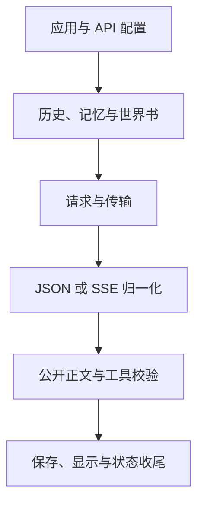
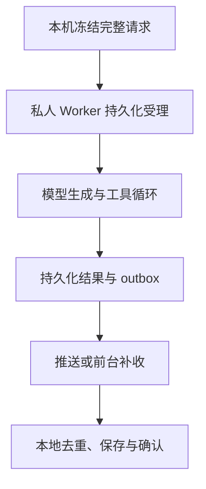

# Lemuria 回复链路检修与 SullyOS 参考清单

日期：2026-11-28（中国时区）。检修基线：Lemuria `main@5f9edaed2e5a078508f6ec8f031367399b60d51b`。

上游架构阅读基线为 `qegj567-cloud/SullyOS@3452415a92f58a53a16394100321bb34a7d6831a`；随后核对到 `49ed3ca1e4f928a1f5051f6cb911d77ed356f76e`，新增变化仅涉及通道退出进度、停止等待 Worker 和相关测试，不改变下面的回复架构结论。更新观察窗口为 2026-08-28 至 2026-11-28。

## 1. 检修结论与证据边界

已复现两个可以跨应用影响回复的代码缺陷：角色回复必须符合随机标签才被接收，以及云端适配器必须等响应流关闭才返回。另有多处诊断会把“没有用量”“正文未通过校验”“联网失败”混为一谈。

这些缺陷已在隔离修复分支中处理，并以合成 HTTP 响应测试真实调用入口。现有用户材料只有脱敏请求报告、截图和资讯 GET 错误，没有失败那次的模型响应体，因此仍不能断言其中任何一项是该次线上故障的唯一原因。离线通过也不等于正在运行的网页和私人 Worker 已更新。

| 项目 | 证据与影响 | 本轮处理 |
|---|---|---|
| 随机回复标签成为硬性前提 | [11 月 26 日改动](https://github.com/chenhaohaot27-eng/SullyOS/commit/4b4c701aecf8e1a90ab8637ff702abb9afa9d566) 将普通聊天、陪伴、故事等接入共同验证器。正常公开正文缺少本轮标签，也会抛 `LLM_REPLY_BOUNDARY`。OpenAI JSON/SSE、Gemini Native JSON/SSE、Worker adapter 均可复现。 | 兼容公开纯文本、VN、OBSERVE、JSON；出现回复标签时仍严格校验本轮唯一完整配对。 |
| 云端收到结束标记后仍等待 EOF | `characterTransport` 原来先 `await response.text()`。模型已发送正文、finish、usage、DONE，HTTP 流保持打开时，SDK 得不到完成结果。 | 浏览器与 Worker 共用轻量按块 reader；DONE 立即完成，finish 后使用固定 1 秒收尾窗口。 |
| finish-only 流无限等待 | 本地原 reader 识别 DONE，却不会在仅有 finish_reason 的常开连接上结束。 | 收尾窗口不被心跳延长；保留窗口内的 usage，未完整的尾部 usage 不让已完成正文失败。 |
| 脱敏报告误称完成了重复检查 | 先把正文改成短占位串，再跳过所有少于 160 字符的内容，最后仍显示“未发现重复”。 | 显式识别新旧脱敏报告，显示“无法判断”；移除将问题归因于中转二次拼接的断言。 |
| HTTP 成功遮住正文校验失败 | transport 与 usage 日志先写成功，角色最终校验在其后。 | 同一请求 ID 合并独立 `replyValidation` 字段；迟到 usage 不覆盖校验失败，抓包 TXT 同步显示。 |
| 响应解析错误误报为断网 | 全局 fetch 的流式升级在拿到 HTTP 响应后可能抛错，却落入网络失败 catch。 | 区分是否已取得响应头；已收到响应的读取/解析错误不再触发域名连通性推测。 |
| 资讯 GET 日志混入模型计费文案 | 复检函数对所有域名使用“原 POST、模型生成”描述。 | 普通请求仅报告域名复检的有限结论；模型请求单独补充其特有语义。 |

### 已排除或尚未证实的判断

- 当前 fork 的 DONE 路径已经使用不等待的 `reader.cancel()`。真实 `Response.clone()` 双分支测试证明这里能够返回；上游存在的 awaited-cancel 风险不能直接套用到这个 fork。
- 资讯主源各平台 GET 的快速失败会被捕获并返回空结果。陪伴 Session 不调用该实时资讯准备路径；这些 GET 失败无法独立解释两种模式共同失效。
- “未取得 usage”不能证明模型没有生成，也不能证明正文已经成功交付。模型响应的用量与回复处理状态分开记录。
- 脱敏请求中存在少数超长历史消息。普通聊天和陪伴共享角色历史池，可以解释两种模式带入相同记录；目前没有证据证明诊断模块把报告写回了聊天数据库。
- 没有真实服务商响应或明确超限错误，不能单凭字符数认定超上下文。字符数也不等于 Token 数。

## 2. 应保持清晰的架构边界

### 本地回复



API 配置应整套解析：应用覆盖、角色专属 API、全局 API 的优先级不能变成从不同站点拼接 URL、key、model。角色历史保留 role 和相对位置，世界书深度依此注入。记忆召回由调用入口显式准备，ContextBuilder 不会自动读取全部记忆。

传输层负责 HTTP、取消、超时与协议解析；正文层负责公开内容、思考段、工具与回复格式。某站点的兼容要求应限制在对应协议或 provider 分支，不能无条件变成所有应用的内容契约。

本轮仍采用完整回复校验后交付；没有将 reasoning、thought、草案补作角色正文，也没有增加自动付费重发。

### 云端即时对话



`202 + task UUID` 只代表任务受理；模型完成、结果送达、本地保存是后续状态。用户自己的主动消息 Worker、中心代理、主站 relay 具有不同职责和部署方式。上游已撤回一版主站模型 relay，不能假定主站会自动代理全部模型请求。

主要上游契约：[API 优先级](https://github.com/qegj567-cloud/SullyOS/blob/3452415a92f58a53a16394100321bb34a7d6831a/utils/characterApi.ts)、[上下文构造](https://github.com/qegj567-cloud/SullyOS/blob/3452415a92f58a53a16394100321bb34a7d6831a/utils/context.ts)、[即时对话端点与信封](https://github.com/qegj567-cloud/SullyOS/blob/3452415a92f58a53a16394100321bb34a7d6831a/plans/amsg2-instant-chat-contract.md)。

## 3. 最近三个月值得参考的更新

下表排除 3D 家园、捏人、社区与虚拟小游戏。混合提交只参考其中相关部分，不整包覆盖 Lemuria。这里区分已落代码、回滚和规划；有代码也不代表相应外部代理已部署或真机验收完成。

| 方向 | 最近更新与来源 | 对 Lemuria 的处理建议 |
|---|---|---|
| 上下文、世界书与角色统计 | 9 月 6 日统一上下文范围；9 月 22 日统一世界书管线，见面与通话支持指定历史深度及关键词触发。[上下文改动](https://github.com/qegj567-cloud/SullyOS/commit/1aebada)、[世界书管线](https://github.com/qegj567-cloud/SullyOS/commit/2546805) | 优先核对消息 role、深度、触发文本和手动/自适应范围；保持角色与应用语义。 |
| API 配置与原生协议 | 10 月 4 日角色专属 API；10 月 29 日聊天和主动消息加入 Anthropic Messages 与缓存。[角色 API](https://github.com/qegj567-cloud/SullyOS/commit/2026b81)、[Anthropic](https://github.com/qegj567-cloud/SullyOS/commit/c1dcae6) | 参考独立适配层和整套配置优先级；保留 Lemuria 现有 Gemini Native 路径并做协议矩阵。 |
| 云端即时对话与主动消息 | 9 月凭据刷新、频率额度、收件箱补收和失败重试治理；10 月任务生命周期与 D1 用量治理；11 月云端恢复、诊断、能力检查和本地/云端提示词对齐。[凭据刷新](https://github.com/qegj567-cloud/SullyOS/commit/ad24bd4)、[任务生命周期](https://github.com/qegj567-cloud/SullyOS/commit/4c708f9)、[提示词对齐](https://github.com/qegj567-cloud/SullyOS/commit/be493693) | 优先借鉴持久化状态、去重与参数一致性。SDK、schema、租约和私人鉴权需要逐项对齐；禁止以旧源码替换较新运行包。 |
| 云端扩展的成熟度 | 11 月 24 日“本机拼请求、云端代跑”扩展提交主要是文档。Date 等应用继续接入云端仍有待办。[规划](https://github.com/qegj567-cloud/SullyOS/commit/bd004f3) | 作为后续设计参考，不能描述为所有功能已经统一上云。 |
| 记忆宫殿与远程向量 | 事件盒摘要再生、可逆相对日期标注、保留长摘要、按年月日修改记忆日期、旧 Supabase 向量库兼容与断点补齐。[事件盒](https://github.com/qegj567-cloud/SullyOS/commit/128ba9e)、[日期修改](https://github.com/qegj567-cloud/SullyOS/commit/147b817)、[旧向量库](https://github.com/qegj567-cloud/SullyOS/commit/a1f1549) | 参考失败阶段、召回覆盖和迁移恢复；与回复链路修复分批验收。 |
| 陪伴、故事与时间语义 | 故事转记忆、事件摘要再生、虚构故事/无现实时间见面与真实时间隔离、对话校准预览及回执。[故事转记忆](https://github.com/qegj567-cloud/SullyOS/commit/7495fa3)、[时间隔离](https://github.com/qegj567-cloud/SullyOS/commit/00a317e) | 优先统一上下文入口和错误收尾，保留模式之间有意的时间与叙事差异。 |
| 语音与通话 | 10 月 ElevenLabs 模型、流式语音与同步字幕，另有 MiniMax、Fish Audio、ElevenLabs STT 选项。[流式语音](https://github.com/qegj567-cloud/SullyOS/commit/8d86815)、[STT](https://github.com/qegj567-cloud/SullyOS/commit/f45ce0c) | 独立验证 TTS/STT 与字幕；相关语音文档仍有待发布和代理部署要求，不能仅复制前端。 |
| MCP 与工具 | 8 月末接入与诊断改进，9 月本地排程工具空回复修复，11 月工具轮次、配置和副作用去重对齐。[MCP](https://github.com/qegj567-cloud/SullyOS/commit/926ad17)、[空回复](https://github.com/qegj567-cloud/SullyOS/commit/bb8ec04) | 继续保持本地/云端工具执行和回复正文分开；按能力与任务 ID 验证一次性副作用。 |
| 备份、用户空间与恢复 | 10 月控制导出内存；11 月独立用户空间、多用户分页导出/恢复和失败反馈。[内存优化](https://github.com/qegj567-cloud/SullyOS/commit/7c4091b)、[分页备份](https://github.com/qegj567-cloud/SullyOS/commit/5b559e0) | 数据保护是下一优先级；先验证导出可恢复，再考虑数据库迁移。统一 v2 格式和上传管线仍未全部落地。 |
| 数据库救援与角色快照 | 11 月 28 日坏库逐记录抢救导出、原角色 ID 占位、独立三槽角色安全快照。[救援实现](https://github.com/qegj567-cloud/SullyOS/commit/4601c21) | 值得单独移植；救援依赖仍可读取的数据或快照，不能恢复已彻底丢失的正文。 |
| 角色资料与聊天管理 | 角色转移、批量气泡重写、资料导入提示、聊天收藏、对话校准等。[聊天管理](https://github.com/qegj567-cloud/SullyOS/commit/b532cb9)、[角色转移](https://github.com/qegj567-cloud/SullyOS/commit/9470c4f) | 在主链稳定后逐项核对；涉及删除、转移和重写时保持原记录归属与可恢复性。 |
| 移动端与发布通道 | Android 更新下载、原生非流式 HTTP；11 月 28 日通道退出进度与停止等待 Worker。[原生 HTTP](https://github.com/qegj567-cloud/SullyOS/commit/ad1ba12)、[通道退出](https://github.com/qegj567-cloud/SullyOS/commit/5d6a538) | Android 能力不能解决 iOS Safari 的传输问题；通道切换需要独立处理前端与 Worker 的更新状态。 |
| 主站 relay | 11 月 26 日明确撤回 PR 905 的 site model relay。[回滚](https://github.com/qegj567-cloud/SullyOS/commit/a54be522) | 以回滚后的真实架构为准，不恢复已撤回方案作为本次快速修复。 |

## 4. 本次源码变更

- `replyBoundary`：公开正文兼容；明确思考段隔离；错误、重复、残缺或其他请求的 frame 仍失败；合法 frame 的框外内容不参与兜底。
- `openAiStream`：统一轻量 reader，无浏览器存储或日志依赖；JSON/SSE、错标 Content-Type、UTF-8 分片、真实 EOF 与协议结束分别处理。
- `safeApi` / `characterTransport`：接入同一个 reader，保留完成状态与工具约束；没有新增自动重发。
- `chatCompletionClient`：将请求 ID 传到实际 transport 与最后的正文校验。补记只包含元数据与可用 usage/finish reason，不保存响应正文。
- `apiCallLog` / 设置面板：HTTP 与正文校验分开；脱敏重复检查显示不可验证；用量缺失采用准确描述；历史 user 消息不再全称为本轮输入。
- `OSContext` / 网络诊断：已收到响应后的错误按处理阶段展示；域名可达不能证明原请求的 CORS、路径、方法或响应内容正确。
- 协议矩阵参考站筛选：排除已经明确正文校验失败的记录。

## 5. Worker 发布边界

检修时线上发行基线 `amsg-worker-2026-11-26.bundle.js` 的 SHA-256 为：

```text
e376c8e8db133332717757d7f11e191ad5cf6883c37eac9421fcbc8259e10359
```

包内包含旧的严格回复边界，已从真实包中提取入口并用离线响应复现。前端源码修复不会自动改变已经运行的 Worker。

历史提交正文提到 Worker 源提交 `e9252af6b295a3f67f22f9f911aaff4e8ba918f9`，本次在仓库可达引用和 GitHub API 中未能取回。主仓 `worker/amsg` 的旧 SDK 源码与发布包的 `3.2.0-lease-token` 契约不同，因此不能直接从旧源码全量重打包覆盖。

本轮 Worker 候选采用可复现的成品包补丁：严格核验原包哈希，只替换三个已审查的叶子模块、版本标识与能力标记；其余区域保持原字节。候选附带生成脚本、来源 manifest 和真实成品包离线测试。这是基于已发布包的派生修复，完整 Worker 的源代码可重建性仍需后续补齐。

运行环境中的 `AMSG_BUNDLE_URL` 与 `AMSG_BUNDLE_SHA256` 必须与新包配套。仅更新网页的 release manifest 不会修改已部署 Worker 的环境变量。现有旧版本的自更新入口也有版本门禁；本轮升级应按候选说明手动部署已验证包并检查 `/config-check`，不能把一次前端发布描述成后端已经完成升级。

本分支已将前端 pin 更新为 `2026-11-28`，候选文件为 `public/amsg-worker-2026-11-28.bundle.js`，SHA-256：

```text
3523da5c27d66dfe3958dfc27fdad461544138688c896cc9bba965da36dd5c55
```

部署顺序：

1. 审阅并合并到 `main`；现有 Pages workflow 会自动发布前端和版本化静态包。核对 workflow 对应的提交和最终成功状态。
2. 在原有私人 Worker 上安装同一候选，保留绑定、环境变量和数据库；无需重建 D1 或运行新迁移。待 Pages 包可用后，将该 Worker 的固定来源设为 `https://chenhaohaot27-eng.github.io/SullyOS/amsg-worker-2026-11-28.bundle.js`，哈希使用上值。
3. 从实际运行实例读取 `/config-check`，确认 `workerVersion: 2026-11-28`、`releaseChannel: lemuria-amsg`、`schemaProtocol: 3.2.0-lease-token`、`replyBoundaryVersion: 2` 和所需任务能力。
4. 再做少量真实会话验收；目前的离线结果不能替代这一步。

旧版本化包仍保留。需要回退时同时回退前端 pin、Worker 运行代码及其固定来源，避免网页与后端各停在一个版本。

## 6. 验证范围

已完成真实函数入口的离线验证：OpenAI JSON/SSE、Gemini Native JSON/SSE、Worker adapter、原生工具与签名续跑、三类公开正文格式、错误 frame、思考隔离、流式结束、clone 双分支、用量尾帧和数据库按 ID 合并。模型 HTTP 均为本地合成 fixture，没有真实模型调用。

最终验证：20 个测试文件、250 项测试通过；其中真实完整 Worker 包在离线 VM 中覆盖 15 类协议、流式和能力场景。`pnpm run build` 通过，包含 Worker pin 哈希校验、前端生产构建和仓库的私有数据检查。`node scripts/build-amsg-reply-hotfix.mjs --check` 可复现候选及 provenance；`git diff --check` 通过。

验证限制：

1. finish 后超过 1 秒才送到的 usage 不保证取得；已完成正文仍正常返回。
2. 没有任何协议终止信号的流，继续受调用方超时与不完整响应规则约束。
3. 通过正文校验不等于后续数据库写入、UI 显示和云端投递已经在真机验收。
4. 当前 `metadata.lemuriaReplyVerified` 门禁要求 Worker 具备对应能力；更旧 Worker 的兼容和升级需要单独核对，不能放开为无条件信任旧回复。

## 7. 下一批检修项目

先完成前端与私人 Worker 的配套发布核验，再做以下整理：

1. **超长历史来源与请求预算。** 先读取源记录 ID、type、source、创建时间和字符数。当前范围主要按条数与记忆水位线筛选，一条超长记录仍完整进入请求。预算应作用于本轮发送副本，保留数据库原文，并明确显示省略/摘要策略；不以删历史掩盖问题。
2. **可选实时信息超时。** 资讯、天气和兜底来源缺少整体等待上限。普通聊天在准备提示词时会等待这些可选数据；需要统一短超时及缓存降级。
3. **普通聊天与陪伴的历史范围一致性。** 手动模式与水位线的处理存在分歧，应先列明有意差异，再统一实现。
4. **完整 Worker 源与发布流程恢复。** 让 SDK 版本、数据库契约、源提交、artifact 哈希、前端 pin 和运行实例可以一一对应。
5. **数据保护独立验收。** 参考上游救援与多槽快照，验证角色、历史、记忆、附件和用户空间的导出—恢复闭环后再进行结构迁移。

线上验收只需少量受控样本，分别覆盖普通聊天、陪伴、实际启用的云端路线及所用协议；每次同时核对调用记录、正文校验、显示、保存与任务状态。失败后先保留该次证据，避免把不同请求的日志拼成一条因果链。

## 8. 词元接入复检（2026-11-28，第二轮）

本轮基线为已合并的 `main@d2b3be4`。前一轮 Pages 发布和私人 Worker `2026-11-28` 已分别核验完成。本节记录后续的连接测试 HTTP 400 复检，不能将两轮不同请求的错误合并归因。

### 真实服务商证据

经用户授权，读取现有令牌对应的模型目录，并做了 8 次短合成生成请求。只使用 `Hi`、`Reply with exactly OK.` 及简短合成角色指令，没有发送真实角色历史。所有请求均为 HTTP 200；截图中那次 HTTP 400 未复现，服务商日志只提供通用参数错误，尚不足以确定具体拒绝字段。

| 样本 | 路径与变量 | 结果 |
|---|---|---|
| 1 | 3.8 Flash，OpenAI JSON，重放原测试形状，`max_tokens: 5` | 有正文，`finish_reason: length` |
| 2 | 只将输出上限改为 128 | 有正文，仍为 `length` |
| 3 | 上限 1024，要求仅回复 OK | `OK`，`stop` |
| 4 | 样本 3 增加 `temperature: 0.85` | `OK`，`stop` |
| 5 | 实际 `completeCharacterChat` 入口，OpenAI SSE，含本轮回复边界 | `OK`，`stop` |
| 6 | 同一生产入口，增加现有混合 thinking/reasoning 字段 | 有可用 OK 正文，`stop` |
| 7 | 实际生产入口，3.8 Flash，Gemini Native JSON | `OK`，`stop` |
| 8 | 实际生产入口，4 Argon，Gemini Native SSE | `OK`，`stop` |

这证明测试时的令牌与上述服务商路线能够生成并通过生产解析器；尚未覆盖 iPhone Safari 的跨域网络、真实长上下文、当地路由和最终 UI 保存。因此没有把“5 token 非法”或“混合 thinking 一定导致 400”当作结论，也没有为此增加站点特判或自动重发。

当前认证 `/v1/models` 返回的能力为：

| 模型 | `supported_endpoint_types` | 配置依据 |
|---|---|---|
| `gemini-3.8-flash` | `gemini`, `openai` | 两种现有请求格式均有目录声明，JSON/SSE 路径已有上述成功样本 |
| `gemini-4-argon` | `gemini` | 优先使用目录声明的 Gemini 原生格式；这不否定历史兼容接口成功记录 |

调用说明来源：[词元 Chat 兼容接口](https://tokenmarket.apifox.cn/502442100e0)、[Gemini 原生](https://tokenmarket.apifox.cn/502442072e0)、[Gemini 原生流式](https://tokenmarket.apifox.cn/502442073e0)。目录能力按站点当时返回值处理，不将型号名当作永久协议规则。

### 已确认并修复的问题

1. **显式流式参数被覆盖。** 全局升级器原先会把请求自己的 `stream: false` 改成 `true`；现在显式 true/false 都保留，仅缺省字段继承全局偏好。协议矩阵的“全局升级”样本改为真正省略 stream。截图失败请求在服务商端为非流式，此修复不能单独解释该次 400。
2. **健康检测预算与结果判定。** 连接测试原上限只有 5，真实样本已观察到输出截断。改为单条合成提示、上限 1024、零自动重试；完整可用正文、达到输出上限、空正文、实际失败分别显示，思考内容不补作正文。
3. **模型目录能力丢失。** 保留模型的 `supported_endpoint_types`，提供 OpenAI 兼容 / Gemini 原生标签与显式草稿切换按钮。能力只存在当前 URL/Key 对应的组件内存；迟到响应不能污染新站点。刷新目录不再自动替换当前模型，缺失或未知元数据不推断不兼容。
4. **请求诊断误导。** 缺失 thinking 字段现在显示“未发送（服务端默认）”，同时记录实际发出后的 stream、输出上限、已知推理字段和消息结构。摘要有长度上限，并排除正文、凭据和任意扩展值。
5. **Gemini 原生用量漏记思考。** 原生候选输出与 thoughts 分开报告，转换时原先只计候选输出。共享归一化函数现在仅加上明确、有限、非负的 `thoughtsTokenCount`，并保留 reasoning 明细；优先使用上游 total，不从差额猜思考，不重复叠加已归一化 completion。JSON、SSE 与调用记录使用同一口径。参见 [Google UsageMetadata](https://ai.google.dev/api/generate-content#UsageMetadata)。

一次外部 OPTIONS 观察到 `Access-Control-Allow-Headers: *`。按照 [MDN 的 Authorization 说明](https://developer.mozilla.org/en-US/docs/Web/HTTP/Reference/Headers/Access-Control-Allow-Headers)，这不能代替显式授权 Authorization 头；但截图原请求确实到达服务商并显示 HTTP 400，因此该单次预检结果只作为浏览器复检线索，不能认定为原故障根因。

本轮改动不需要重新部署私人 Worker，不涉及 Cloudflare 付费套餐、数据库迁移或聊天记录清理。最终发布与 iPhone 验收应通过构建提交号确认版本，避免仅根据刷新动作判断已更新。

最终本地验证：14 个相关测试文件、206 项测试通过，覆盖连接测试、预设接线、请求摘要、显式流式、协议矩阵、模型能力异步隔离、Gemini 用量、正式聊天解析入口和调用日志。`pnpm build` 通过，包含既有 Worker pin 校验及私有数据检查。没有为了计数修复额外消耗真实模型额度。
